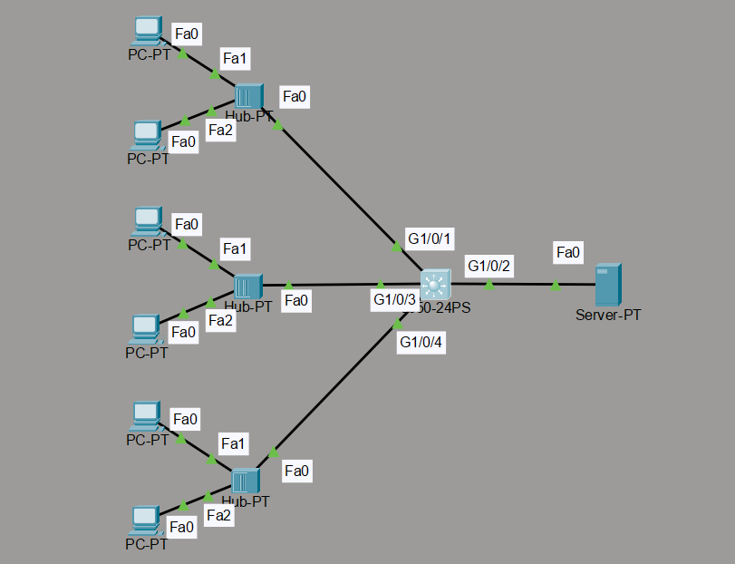

#  Switch Port Security Lab – Cisco Packet Tracer

##  Overview

This lab demonstrates how to configure and test **Switch Port Security** on a Cisco switch using Cisco Packet Tracer. The objective is to restrict unauthorized devices from accessing the network through switch ports by controlling which MAC addresses are permitted.

The lab explores static and dynamically learned MAC address security, violation behavior, and the effect of restarting a switch without saving its configuration.

##  Objectives

- Understand the purpose of switch port security.
- Configure port security on interface `GigabitEthernet1/0/1`.
- Learn how MAC addresses are permitted by default.
- Verify that only the first connected host is allowed.
- Observe what happens when a second host sends traffic.
- Understand the difference between running and startup configurations.
- Configure port security on `GigabitEthernet1/0/3` with automatic MAC address learning.
- Compare the behavior of both configurations after a switch restart.

##  Lab Topology

 
 
**Devices used:**
- 1 × Cisco 2960-24PS switch
- 6 × PCs
- 3 × Hubs
- 1 × Server
- Cisco Packet Tracer

**Topology summary:**

- Three hubs connect multiple PCs to the switch.
- The first hub connects to `GigabitEthernet1/0/1`.
- The second hub connects to `GigabitEthernet1/0/3`.
- The third hub connects to `GigabitEthernet1/0/4`.
- The server connects to `GigabitEthernet1/0/2`.

> Note: The switch interfaces are the focus of this lab. Port security is configured on the switch ports connected to the hubs.

## Part 1: Configure Port Security on G1/0/1

### Step 1: Enter configuration mode

```text
enable
configure terminal
```

### Step 2: Configure the switch interface

```text
interface GigabitEthernet1/0/1
switchport mode access
switchport port-security
switchport port-security maximum 1
switchport port-security violation shutdown
end
```

### Step 3: Verify the configuration

```text
show port-security
show port-security interface GigabitEthernet1/0/1
show port-security address
show running-config
```

### 🔍 Observations

**1. How are MAC addresses permitted by default?**

When port security is enabled without explicitly configuring the maximum, the default maximum is **one secure MAC address** per port. By default, the switch learns secure MAC addresses dynamically.

**2. What happens when the first host sends traffic?**

The switch dynamically learns the first host's MAC address as a secure MAC address.

**3. What happens when the second host sends traffic?**

Because the interface permits only one secure MAC address, traffic from another MAC address causes a port-security violation. With the `shutdown` violation mode, the switch places the interface into an error-disabled state.

**4. Is the first host's MAC address saved in the running configuration?**

No. A dynamically learned secure MAC address is maintained as operational port-security state; it is not normally written as a static MAC-address command in the running configuration.

**5. What happens after a switch restart?**

The dynamically learned secure MAC address is not permanently retained unless it is saved through an appropriate mechanism, such as port-security sticky learning followed by saving the configuration. After a restart, the switch can relearn the address from traffic.

##  Part 2: Configure Port Security on G1/0/3

In this part, the switch automatically learns the secure MAC address and adds it to the running configuration using **sticky learning**.

### Step 1: Configure the interface

```text
enable
configure terminal
interface GigabitEthernet1/0/3
switchport mode access
switchport port-security
switchport port-security maximum 1
switchport port-security violation shutdown
switchport port-security mac-address sticky
end
```

### Step 2: Verify the configuration

```text
show port-security interface GigabitEthernet1/0/3
show port-security address
show running-config
```

###  Observations

**1. What happens when the first host sends traffic?**

The switch learns the host's MAC address and converts it into a sticky secure MAC address.

**2. Is the learned MAC address written to the running configuration?**

Yes. After the address is learned, the running configuration can contain a line similar to:

```text
switchport port-security mac-address sticky XXXX.XXXX.XXXX
```

The actual MAC address depends on the connected host.

**3. What happens when the second host sends traffic?**

The second host triggers a port-security violation because the maximum number of secure MAC addresses is one. With the shutdown violation mode, the port is placed into an error-disabled state.

**4. What happens when the switch is restarted without saving the configuration?**

Sticky MAC addresses and configuration changes that exist only in the running configuration may be lost. The switch reloads its startup configuration, which can cause the interface to relearn a MAC address if sticky learning is no longer configured.

To preserve the sticky MAC address across a reload, save the configuration:

```text
copy running-config startup-config
```

##  Verification and Testing

Use the following commands during testing:

| Command | Purpose |
|---|---|
| `show port-security` | Displays port-security status across interfaces |
| `show port-security interface GigabitEthernet1/0/1` | Displays security settings and violation counters |
| `show port-security address` | Displays secure MAC addresses |
| `show running-config` | Checks the active configuration |
| `show startup-config` | Checks the saved configuration |
| `show interfaces status` | Checks interface status |
| `show interfaces status err-disabled` | Checks for error-disabled ports, where supported |

If a port enters the error-disabled state, inspect the violation counters and interface status before recovering it. After removing the test condition, an administrator can manually recover the port:

```text
configure terminal
interface GigabitEthernet1/0/1
shutdown
no shutdown
end
```

Only recover the port after confirming that the test or unauthorized device has been removed.

##  Key Findings

| Feature | G1/0/1 | G1/0/3 |
|---|---|---|
| Port security | Enabled | Enabled |
| Maximum secure MAC addresses | 1 | 1 |
| MAC learning | Dynamic | Sticky |
| Learned MAC in running config | Normally no | Yes, after learning |
| Violation mode | Shutdown | Shutdown |
| Persistence after reload | Can relearn dynamically | Requires saving sticky configuration for persistence |

##  What I Learned

- How Cisco switch port security limits access using secure MAC addresses.
- How the default maximum secure MAC address count works.
- How to configure a port-security violation mode.
- How a second MAC address triggers a security violation.
- How dynamic and sticky MAC address learning differ.
- Why the running configuration and startup configuration are important.
- How to verify port-security behavior using Cisco IOS commands.

##  Conclusion

This lab demonstrates how switch port security helps prevent unauthorized devices from connecting through access ports. By comparing dynamic and sticky MAC learning, I learned how to control the number of permitted devices and how configuration persistence affects network security after a switch restart.

**Skills practiced:** Cisco IOS, LAN security, MAC address learning, port-security violations, configuration verification, and troubleshooting.

---

